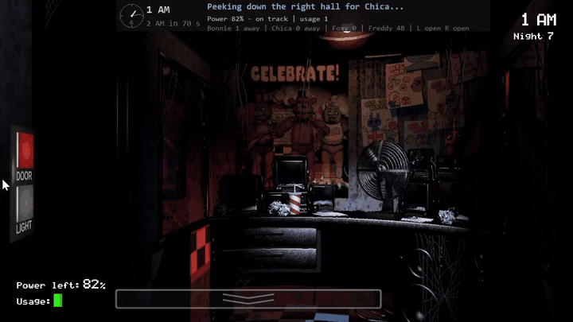
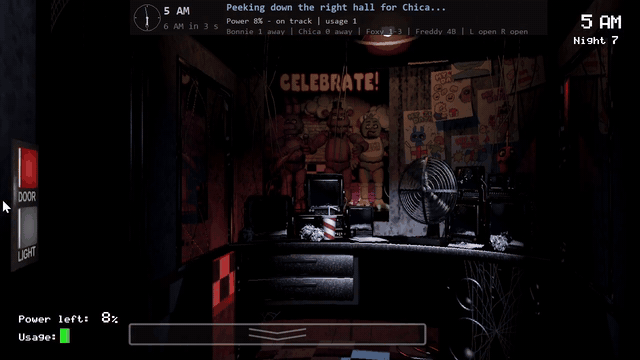
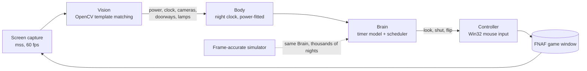

# FNAF Automations

**A computer-vision bot that plays *Five Nights at Freddy's* by itself: it reads the screen with OpenCV, decides with a model of the game's own timers, and plays with the mouse, like a person would.**




*Live, Custom Night 20/20/20/20 (every animatronic at maximum). Chica appears at the right door; the bot schedules the door to shut 0.5 s before her next possible move, keeps the light on across that move to watch her leave, and reopens the door the moment she has gone. The panel at the top is the bot narrating its own decisions.*

**[Download FNAFBot.exe](https://github.com/phonehseng/Fnaf-automations/releases/latest)** · [How it works](#how-it-works) · [Engineering highlights](#engineering-highlights) · [Devlog](docs/DEVLOG.md)

---

## Results

| Night | Live result | Power at 6 AM |
|---|---|---|
| Nights 1 - 5 | won | 41 %, 16 %, 34 %, 8 %, 2 % |
| 6th Night | won | 0 % |
| Custom Night **20/20/20/20** | won **13 of the last 20** live attempts | 0 - 11 % |
| 20/20/20/20 in the simulator | **1000 of 1000** won | 4 % at least, 15 % on average |



At 20/20/20/20 the game is a power budget: a perfect night has only about 28 % of the battery to spend, and every live loss in the last 20 attempts but one was the power running out shortly before 6 AM, not a mistake at a door. Each lost night is written up in [docs/DEVLOG.md](docs/DEVLOG.md): what the log showed, what the game's code says, the measurement that settled it, and the fix.

## Quick start

1. Download **`FNAFBot.exe`** from the [latest release](https://github.com/phonehseng/Fnaf-automations/releases/latest) and put it in its own folder.
2. Double-click it. In the window, check that it found your copy of the game (Steam version), pick what to play, and press **START**.
3. Hands off the mouse while it plays. **F8** stops it at any time.

The first START copies the reference pictures out of your installed game (once, about 30 seconds). Logs, pictures of every doorway decision and settings are kept next to the .exe.

Prefer the command line? The .exe takes the same options as the source version, for example `FNAFBot.exe --custom 20 20 20 20` (see [Running from source](#running-from-source)).

## How it works



FNAF 1 runs on fixed timers: Bonnie may move every 4.97 s, Chica every 4.98 s, Foxy every 5.01 s, Freddy every 3.02 s, and power is charged once a second. These rules were read out of the game's own event code ([docs/GAME_LOGIC.md](docs/GAME_LOGIC.md)). So the bot does not react to what it happens to see; it keeps a precise clock of the night and knows *when* each animatronic can possibly have moved:

* **Bonnie and Chica**: it looks at a doorway only after a tick in which they could have arrived, and shuts the door *just in time*, about half a second before their next move, so the door costs almost no power.
* **Foxy**: he can only move if no camera has been up recently, so the camera is flipped up for a fraction of a second just before each of his ticks.
* **Freddy**: the monitor always rests on the one camera from which he can never get in.
* **Power**: lights and camera flips are timed between the once-a-second power charges, so most checks are free.

More in [docs/STRATEGY.md](docs/STRATEGY.md).

## Engineering highlights

**Computer vision (OpenCV, NumPy)**
* Reference pictures come from the game itself: `assets.py` parses the Clickteam Fusion data pack inside your installed `FiveNightsatFreddys.exe` (the chunk format, zlib-compressed image bank) and extracts 605 clean images. No hand-made screenshots, and nothing from the game is redistributed.
* HUD numbers (power, clock, night) are read by template matching against the game's own digit bitmaps (`cv2.matchTemplate`, `TM_CCOEFF_NORMED`). Pixel-exact, no OCR.
* Camera pictures are classified against every known state of that room at every pan offset, in grayscale at 1/4 size (16x faster, and the TV static averages out). Several frames are scored separately and static-washed frames are discarded.
* Doorways are judged by the margin between "lit and empty" and "lit and occupied" references. A decision is only trusted above a measured confidence margin, and every decision is saved as a small picture for auditing.

**Real-time control**
* A night clock fitted to the game's own power charges with a Theil-Sen regression (robust to bad sightings), so the timers are known to a few hundredths of a second.
* Click scheduling respects the game's 10-frame click cooldown, door animations and the power-charge instants.
* A scheduler that tries every order of the pending doorway checks and the next Foxy flip, and picks the one that meets every safety deadline.

**Reverse engineering**
* The rules (timers, AI rolls, routes, Foxy's lock and fuse, Freddy's entry condition, the camera pause on Pirate Cove) were taken from the game's event code and then checked against live measurements (`tools/measure_*.py`).

**Testing and measurement**
* `fnafbot/sim.py` re-implements a night frame by frame. The *same* brain plays it, so a change can be judged on 1000 simulated nights in about a minute before it goes near the real game.
* Every live night is logged and recorded. [docs/DEVLOG.md](docs/DEVLOG.md) is the lab notebook: 52 entries covering every live loss, each with its cause and fix.
* 64 pytest tests, including **fair-play guard rails** that scan the code: the bot may never read or write the save file, memory or game files while playing.

**Windows integration**
* Direct Win32 mouse input (`pywin32`), window discovery and repair, a click-through status overlay (tkinter) with an analog night clock, a single-instance mutex, a global F8 kill switch, and a one-file PyInstaller build with a launcher window.

## Fair play

During a night the bot only **looks at the screen and moves the mouse**. It never reads or changes the game's save file, memory or files, and reaches every night through the game's own menus, so 6th Night and Custom Night must be unlocked by winning the earlier nights. What it knows in advance is what a player could learn from a strategy guide: the rules, and the reference pictures copied once from your own game during setup. `tests/test_fair_play.py` enforces this.

## Running from source

Windows 10/11, Python 3.12+, and Five Nights at Freddy's (Steam). If the game is not in the default Steam folder, set `FNAF_EXE` to the full path of `FiveNightsatFreddys.exe` (or choose it once in the launcher window).

```bash
pip install -r requirements.txt
```

```bash
python -m fnafbot --setup
```

```bash
python -m fnafbot --campaign
```

| Option | What it plays |
|---|---|
| *(none)* | Opens the launcher window |
| `--setup` | Copies the reference pictures out of your installed game (once) |
| `--new-game` | New Game: Night 1, then each next night until Night 5 is won |
| `--continue` | Continue from the night the game has saved |
| `--sixth` | 6th Night (once unlocked) |
| `--custom 20 20 20 20` | Custom Night with these AI levels (Freddy, Bonnie, Chica, Foxy) |
| `--campaign` | New Game, nights 1 - 5, then 6th Night, then Custom Night 20/20/20/20 |
| `--nights N` | Stop after N nights |

Simulator and tests:

```bash
python tools/simulate.py --custom 20 20 20 20 --runs 500
```

```bash
python -m pytest tests
```

Build the .exe yourself:

```bash
pip install pyinstaller
```

```bash
python tools/build_exe.py
```

## Project layout

| Path | What it is |
|---|---|
| `fnafbot/vision.py` | Reads the HUD, cameras and doorways from screenshots (OpenCV) |
| `fnafbot/assets.py` | Extracts the reference pictures from the game's data pack |
| `fnafbot/brain.py` | The strategy: the timer model, safety deadlines and the scheduler |
| `fnafbot/body.py` | Connects the brain to the real game; the power-fitted night clock |
| `fnafbot/sim.py` | Frame-accurate simulator of a night |
| `fnafbot/controller.py`, `mouse.py`, `screen.py` | Clicks, panning, cameras; window capture |
| `fnafbot/menu.py` | Starts the game and picks a night through its menus |
| `fnafbot/overlay.py`, `narrator.py` | The on-screen status panel and its plain-English commentary |
| `fnafbot/launcher.py` | The window FNAFBot.exe opens |
| `fnafbot/rules.py`, `layout.py`, `catalog.py`, `config.py` | Game rules, screen positions, picture labels, settings |
| `tools/` | Simulator runner, A/B and loss debugging, live calibration scripts, the .exe build |
| `tests/` | pytest suite, including the fair-play checks |
| `docs/` | Game logic, strategy, and the devlog |

## Credits and license

Code: [MIT License](LICENSE). The launcher uses Google Sans and Google Sans Code (SIL Open Font License 1.1, [fnafbot/fonts/OFL.txt](fnafbot/fonts/OFL.txt)). The general approach (screen capture, resolution-independent coordinates, a kill hotkey) is loosely modelled on [BTD6bot](https://github.com/j-miet/BTD6bot).

*Five Nights at Freddy's* is a trademark of Scott Cawthon. This is an unofficial fan project, not affiliated with or endorsed by him. It contains none of the game's files or artwork: the bot uses the copy you own.
